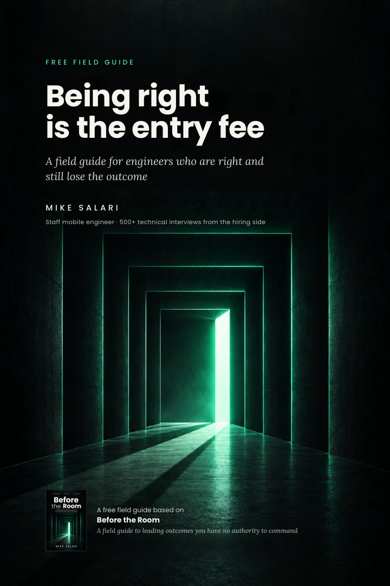

# Being right is the entry fee

**A field guide for engineers who are right and still lose the outcome.**

Free field guide based on *Before the Room* by **Mike Salari** · [salari.dev](https://salari.dev/books/before-the-room)

[**Read on desktop**](Before-the-Room-field-guide-desktop.pdf) · [**Read on your phone**](Before-the-Room-field-guide-mobile.pdf) · [**Buy on Gumroad**](https://mikesalari.gumroad.com/l/before-the-room?utm_source=github&utm_medium=readme&utm_campaign=before_the_room_field_guide) · [**See it on salari.dev**](https://salari.dev/books/before-the-room/?utm_source=github&utm_medium=readme&utm_campaign=before_the_room_field_guide)

---

## The best engineer in the loop was downlevelled

He caught a consistency bug before the interviewer finished drawing the design. He knew the failure modes of the datastore cold. Then the interviewer asked what he would do if the team owning the upstream service refused the change his design depended on, and he said he would explain why they were wrong.

The loop downlevelled him. He had heard a test of whether his design was correct. The question was whether he could move an outcome that lived inside a team he could not command.

You are likely to meet that question at work long before you meet it in a loop: in the review that was decided before you walked in, the agreement that reopens on Thursday, the status update that becomes someone else's promise. This guide gives you the move that comes first.

## What's inside

- **The debrief.** A staff candidate who was right about everything, seen from the hiring side.
- **Three weeks you may recognize.** The review already decided, the review won and reopened, the status update that became a promise.
- **Why good instincts make it worse.** Being more right, working harder and private frustration, and what each one fails to touch.
- **Three cuts, before you answer.** Find the decision under a request, its owner and the incentive that will settle it. A four-line worksheet you can use today.
- **Two worked examples, before and after.** The status question at 4:12 on a Tuesday, and the team that keeps saying no, with the exact words to say.
- **The harder case and the limits.** One decision hidden across three requests, and when the objection in front of you is simply correct.
- **Where Surface stops.** One proposal run through Surface, Shift and Secure in a single week, and what it still cost.
- **The next sentences.** A few of the lines the rest of the book builds toward, and the chapter behind each.

Every scene comes from the book and, like every scene in the book, is a composite. Each page names the chapter it comes from.

## Pick your screen

| Edition | Best for | Pages | Open |
| --- | --- | ---: | --- |
| **Desktop** | Laptop, large screen, print | 12 | [Desktop PDF](Before-the-Room-field-guide-desktop.pdf) |
| **Mobile** | Reading on a phone, no zooming | 17 | [Mobile PDF](Before-the-Room-field-guide-mobile.pdf) |

Same content, two layouts. Free, no email, no sign-up.

## The full book

*Before the Room: A field guide to leading outcomes you have no authority to command.*

Surface hands you the decision. The rest of the book is about what you say once you have it, to whom, and what you put in writing so it holds. When the review ends and everyone nods, you ask who could reopen it who is not in the room. When another team keeps blocking a sound proposal, you stop arguing the architecture and talk about the ownership it moves. When a date was promised before anyone sized the work, you hand the owner three costed options and let them choose the promise. When every team reports green, you say the work is locally complete and the launch path is not proven.

Each of those lines sits at the end of a chapter that does the work behind it: the artifact that carries the decision when you are not in the room, the signal that tells you it held, and the boundary where the move stops applying. Three sections show the method failing, and what to do then.

| Edition | For | What you get | Price |
| --- | --- | --- | ---: |
| **Book** | Learning the system | PDF and EPUB. 137 pages, 20 chapters in five parts, 16 artifacts each with a completed example, 12 figures, an operational index | $99 |
| **Book + Field Kit** | Running it at work | The book, plus the 16 artifacts as fillable PDFs in A4 and US Letter and as editable Word files, the fillable workbook, the Field Card, the Problem to Artifact Map, When the Moves Fail, the Thirty-Day Repair Workbook and the AI Companion | $119 |
| **Team License, 10 readers** | One vocabulary for a team | Everything in Book + Field Kit for up to 10 named readers in one organization, with a Team Guide and a six-week plan for reading it together on real work | $209 |

All three editions are on one Gumroad page; you pick the edition before you pay. Every edition includes lifetime updates.

**[Buy on Gumroad](https://mikesalari.gumroad.com/l/before-the-room?utm_source=github&utm_medium=readme&utm_campaign=before_the_room_field_guide)** · **[See it on salari.dev](https://salari.dev/books/before-the-room/?utm_source=github&utm_medium=readme&utm_campaign=before_the_room_field_guide)**

## Who it's for

Senior, staff and principal engineers, tech leads and architects who are accountable for outcomes across teams they do not manage.

## About the author

**Mike Salari** is a Staff mobile engineer. 15 years across Apple, Adobe, Cisco, Mastercard and Visa, and 500+ technical interviews from the hiring side. He writes about software engineering and careers at [salari.dev](https://salari.dev).

[Website](https://salari.dev) · [LinkedIn](https://www.linkedin.com/in/mike-salari/)

## Sharing and copyright

© 2026 Mike Salari. All rights reserved.

Share the link to this repository freely. The PDFs are free to read for personal use. They are not licensed for redistribution, adaptation or commercial use. For anything beyond reading, ask the author first.
